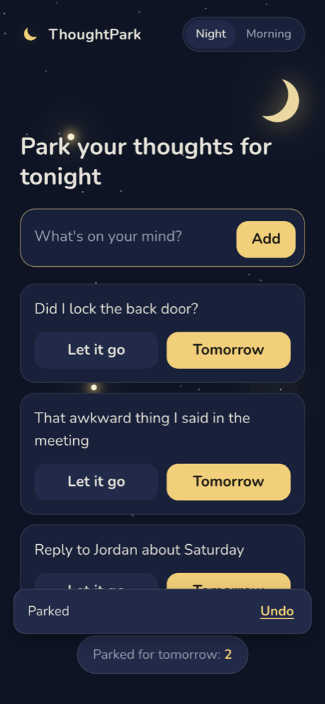
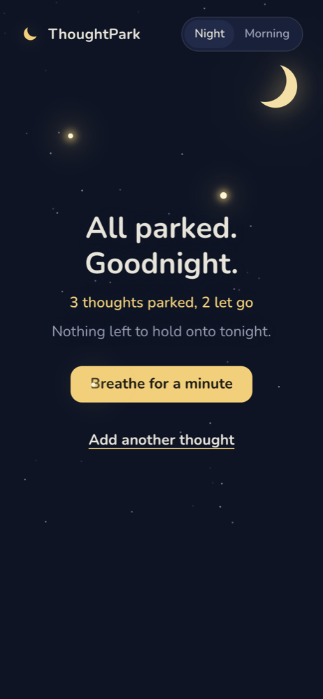
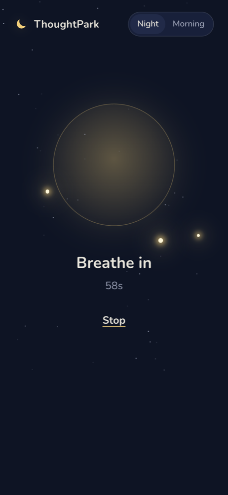
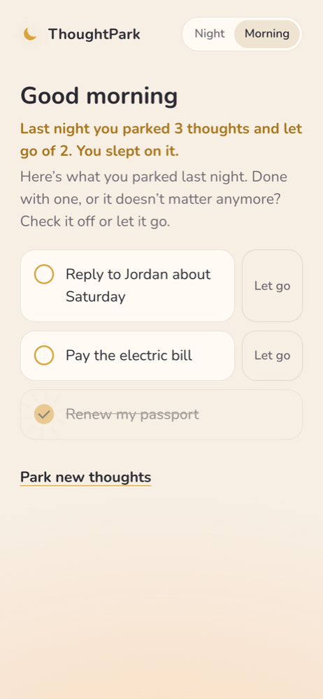
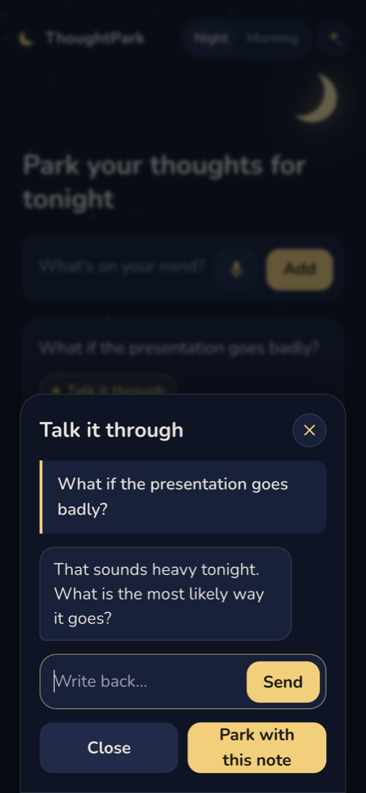
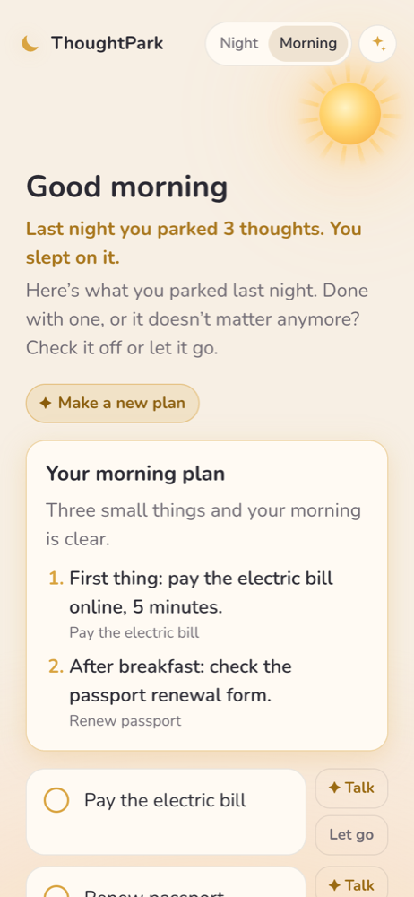
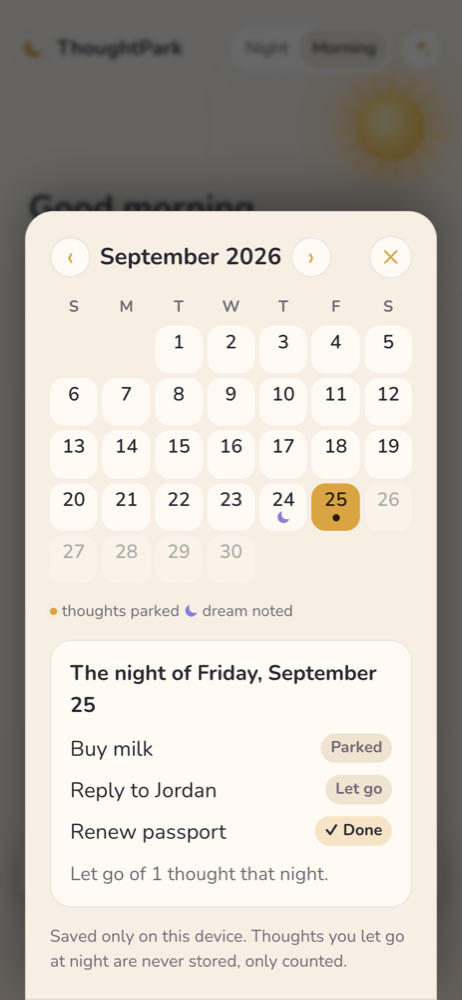
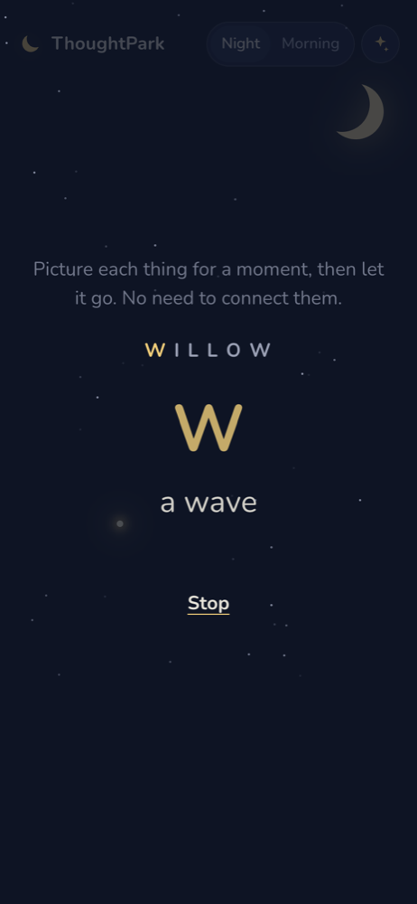

# ThoughtPark

**Park your racing thoughts for the night, and find them waiting in the morning.**

ThoughtPark is a bedtime companion for people who can't fall asleep because their mind keeps looping. At night you type (or say) each thought and make one small decision: **Tomorrow** (keep it for the morning) or **Let it go** (release it for good). When a thought won't settle, **talk it through** with Claude for a minute and park it with a calm one-line note. In the morning, the thoughts you kept are waiting, and Claude can turn them into a short plan.

<p>
  
  
  
  
</p>
<p>
  
  
  
  
</p>

<sub>The chat and plan screenshots show illustrative example text.</sub>

## Why

Lying awake replaying the day, or rehearsing tomorrow, is one of the most common reasons people struggle to fall asleep. In a sleep-lab study, people who spent five minutes writing a specific to-do list before bed fell asleep about nine minutes faster than people who wrote about tasks they'd already finished ([Scullin et al., 2018, *Journal of Experimental Psychology: General*](https://ncbi.nlm.nih.gov/pmc/articles/PMC5758411)).

ThoughtPark turns that into a calm nightly ritual. You don't only write thoughts down; you decide what each one is. Knowing the important ones will be waiting in the morning makes it safe to stop holding them tonight.

## What it does

- **A welcome guide.** First-time visitors get a four-step introduction (empty your mind, park or let go, talk it through, wake up to your list). "How it works" under each screen title brings it back.

- **Park or let go.** Each thought becomes a card. "Let it go" makes it blur and drift away, and it's never saved. "Tomorrow" parks it.
- **Moon and sun.** A crescent moon watches over the night; in the morning it sets and the sun rises in its place.
- **Your thoughts become stars.** Every parked thought appears as a star in the night sky behind the app, always in the same place. Hover over a star (or tap it on a phone) to see which thought it is and when you parked it. Letting a thought go sends a shooting star across the sky.
- **Talk it through (AI).** Any thought can open a short, calm chat with Claude. It works out whether it's a worry (gentle questions: what's likely, what's in your control), a task (one tiny first step), or a regret (a kinder view), wraps up in about three exchanges, and parks the thought with a one-line note you'll see in the morning.
- **Speak instead of type.** Tap the microphone and say everything on your mind; Claude splits it into separate thoughts.
- **Morning plan (AI).** One tap turns your open morning thoughts into a short, ordered plan.
- **Safety first.** Before anything is sent to Claude, the app checks for signs of crisis. If it finds them, it shows the 988 Suicide & Crisis Lifeline (call or text) instead of a chat.
- **Gentle prompts.** If you stop typing, soft questions appear ("Someone you need to reply to?") to help you empty your mind completely.
- **All parked. Goodnight.** When nothing is left, a quiet goodnight screen shows what you parked and released.
- **Help me fall asleep.** After "All parked. Goodnight." four tools help you drift off:
  - **Breathe:** a guided minute (4 seconds in, 6 seconds out).
  - **Mind shuffle:** based on cognitive scientist Luc Beaudoin's "cognitive shuffle" (serial diverse imagining), which was designed for racing thoughts at bedtime. A calm word is spelled out slowly, and for each letter you picture simple, unrelated things ("M… a mitten… the moon… a mug"). This crowds out worry the way the mind naturally drifts at sleep onset ([study](https://www.researchgate.net/publication/300004607_Serial_Diverse_Imagining_Task_A_New_Remedy_for_Bedtime_Complaints_of_Worrying_and_Other_Sleep-Disruptive_Mental_Activity), [SFU](https://www.sfu.ca/main/dashboard/faculty-staff/news/2025/04/reprogramming-rest--sfu-researcher-s-science-of-falling-asleep.html)).
  - **Sleep sounds:** rain, ocean waves, or brown noise, generated live in the browser, with a 15, 30, or 60 minute fade-out.
  - **Sleep story (AI):** pick a setting (a lighthouse, a night train, a snowy cabin, a quiet garden) and Claude writes a slow, deliberately uneventful story that your device reads aloud. Only the setting is sent.
  Each tool ends by dimming the screen to near-black.
- **Morning handoff.** At sunrise each star falls from the sky into your checklist, and a line sums up your night: "Last night you parked 3 thoughts and let go of 2. You slept on it." (Only the counts are kept.)
- **Dream journal (AI).** Note last night's dream before it fades (typed or spoken). **Reflect with Claude** gives a gentle title, the feelings and themes it notices, a short grounded reflection, any echo of the thoughts you parked last night, and one question for the day. Claude is told dreams have no fixed hidden meanings, so there are no symbol dictionaries and no predictions. Past dreams are kept in a journal on your device.
- **Your calendar.** Every night is saved as a day in a month calendar: what you parked (with notes), what became of each thought (done, let go, or still open), how many thoughts you let go that night (only the count, never the words), and the dream you noted the next morning.
- **Does it still matter?** Worries often look smaller in the morning. Check an item off (a small burst of sun rays) or let it go if it doesn't matter anymore, and watch it shimmer like a rainbow and burst into sparkles. When everything is done: "All clear. Have a good day." 
- **Forgiving.** Every park or release can be undone for 5 seconds, which helps with half-asleep taps.
- **Private by design.** No account and no server. Everything stays in your browser on your device, and released thoughts are never stored. The AI features use your own Anthropic API key (Settings, the ✦ button); only the thoughts you choose to talk through, speak, or plan are sent to Claude.
- **Works without a key.** Without an API key the AI features run in a clearly labeled demo mode, so anyone can try the whole flow.
- **Accessible.** Works with keyboard and screen readers, and respects your device's reduced-motion setting.

The app picks Night or Morning from the time of day (morning is 5 am to 5 pm). The toggle in the corner switches manually.

## Try it

**Live:** _link added at submission_

**Run locally** (no install needed, Node 18+ or Python 3):

```bash
git clone <this repo>
cd thoughtpark
npm start          # or: python3 -m http.server 8000
```

Then open the URL it prints (for example http://localhost:3000). A local server is needed because the app uses JavaScript modules.

**AI features:** open Settings (✦ in the top corner) and paste an Anthropic API key from [console.anthropic.com](https://console.anthropic.com/settings/keys). It's stored only in your browser. Without one, AI answers are labeled samples.

**Tests:**

```bash
npm test           # runs node --test on the data logic
```

## How it's built

Plain HTML, CSS, and JavaScript with no framework and no build step. The only runtime dependency is the official Anthropic JavaScript SDK (`@anthropic-ai/sdk` 0.128.0), loaded as a module from jsdelivr for the AI features.

| File | What it does |
|---|---|
| `index.html` | Page shell: sky layer, header with the Night/Morning toggle, main screen, undo toast |
| `css/style.css` | Night and morning themes, cards, sky, breathing circle, reduced-motion rules |
| `js/store.js` | Pure logic with no DOM: adding, parking, releasing, morning order and let go, last night's counts, saving and loading, star positions, prompts, breathing timing |
| `js/sky.js` | The night sky: decorative stars, one star per parked thought with hover/tap info, shooting stars |
| `js/app.js` | Screens and interactions: Night, Goodnight, Breathing, Morning (falling stars, sun-ray burst, All clear, plan), undo, prompts, voice |
| `js/ai.js` | Claude calls: streamed Talk it through, notes, voice splitting, morning plan (structured JSON outputs), demo mode, key storage |
| `js/companion.js` | The Talk it through, Settings, and 988 support panels |
| `js/guide.js` | The four-step welcome guide for first-time visitors |
| `js/calendar.js` | The month calendar of nights and each night's details |
| `js/dreams.js` | The morning dream card: note (typed or spoken), reflect with Claude, edit, delete, and the dream journal |
| `js/sleep.js` | Help me fall asleep: mind shuffle, sleep sounds, sleep story (read aloud with the browser's voice) |
| `js/sounds.js` | Rain, ocean, and brown noise generated with the Web Audio API |
| `tests/store.test.js` | 46 unit tests for `store.js` using Node's built-in test runner |

Data is one JSON object in `localStorage` under `thoughtpark:v1`, holding pending and parked thoughts (with any notes), dreams and their reflections, a per-night history for the calendar (a night runs 5 am to 5 am; the newest 365 are kept), and last night's two counts. The API key is stored separately under `thoughtpark:apiKey`; conversations are never saved.

**Claude details:** model `claude-opus-5` at low effort for short, quick replies; chat replies stream word by word; notes, voice splitting, and plans use structured JSON outputs; requests opt into Anthropic's server-side refusal fallback. The browser talks to the API directly with the user's own key (`dangerouslyAllowBrowser`), which is appropriate here because the key never belongs to anyone else. A hosted version for the public would move the key to a small server. If storage is blocked, the app still works for the session and says that saving is off.

## How this was made

This project was built for Devpost's **Build With AI: Basics** hackathon using the [Devpost Learn Skill Pack](https://github.com/challengepost/learn-ai-basics). It follows a plan-first workflow: scope → product requirements → technical spec → build in small, verified slices. The planning documents are in [`devpost/`](devpost/):

- [`scope.md`](devpost/scope.md): the idea and the proof-of-concept boundary
- [`prd.md`](devpost/prd.md): the product requirements
- [`spec.md`](devpost/spec.md): the technical plan
- [`checklist.md`](devpost/checklist.md): the build slices and revisions

The code was written with **Claude Code** (Anthropic) as the AI coding agent. Details the agent proposed rather than the builder are marked "(proposed)" in the planning docs. No pre-existing code was used apart from the Skill Pack's planning skills, which are included as installed. The only external resource is the Nunito font from Google Fonts.

## What's next
- A small hosted backend so people can use the AI without their own key
- Weekly reflection: which kinds of thoughts keep you up, and what helped

- A morning sleep rating, to see which nights went better
- Carrying unfinished morning items into the next night
- Optional sync across devices

## License

[MIT](LICENSE)
